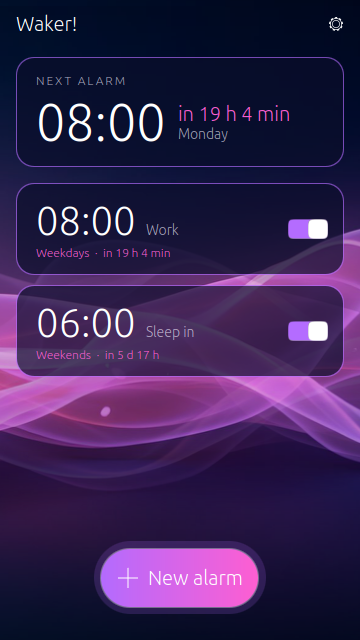
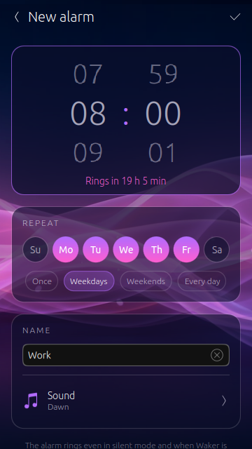
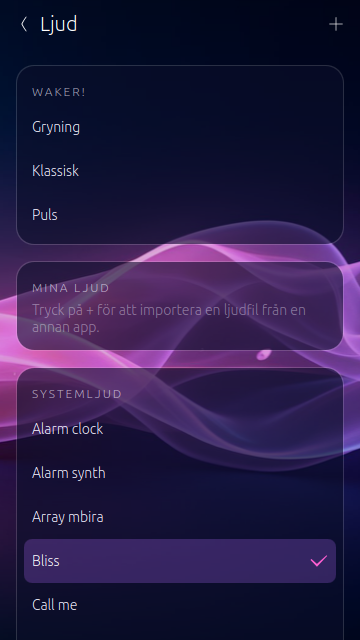
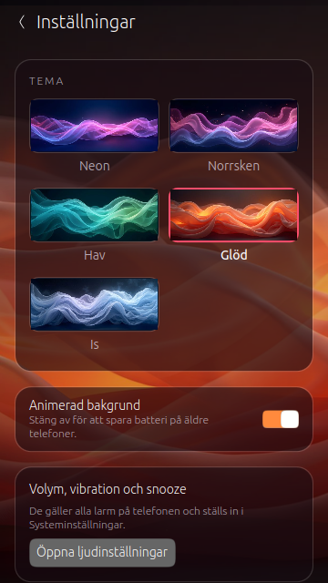

# Waker!

An alarm clock for **Ubuntu Touch** that rings **even in silent mode** – with a
calm, flowing neon look.

**Website & download:** https://waker.sandgren.one (English: https://waker.sandgren.one/en/)

<p>
 
 
</p>

## Features

- One-time or repeating alarms (pick weekdays, or *Weekdays / Weekends / Every day*)
- Countdown to the next alarm ("in 7 h 12 min")
- Three bundled alarm sounds, all system ringtones, or import your own via Content Hub
- Five background themes with matching accent colours
- Light on the CPU: pre-rendered backgrounds that drift slowly, paused when the
  app is not in the foreground, and can be switched off
- English and Swedish

## How it works

Apps on Ubuntu Touch are suspended when they are not in the foreground, so an app
cannot keep its own timer running. Waker therefore uses the system alarm API
(`Alarm` / `AlarmModel` from `Lomiri.Components`). Alarms are stored in
Evolution Data Server and fired by `lomiri-indicator-datetime`, which wakes the
phone, plays the sound with the `alarm` audio role and shows *Snooze / Dismiss*.
The indicator never mutes alarm clocks in silent mode, and it works when Waker is
closed. This requires the AppArmor policy group `calendar` (reserved, so the
OpenStore reviews the app manually). Alarms are shared with the Clock app;
snooze length, alarm volume and vibration are system settings.

## Build

Requires [Clickable](https://clickable-ut.dev) ≥ 8.8 and Docker or Podman.

```bash
clickable build                 # → build/all/app/waker.sandgren.one_<version>_all.click
clickable desktop --lang sv_SE  # UI test on the desktop (alarms use a memory backend there)
clickable install --ssh <phone-ip> && clickable launch --ssh <phone-ip>
```

The app is pure QML, so a single `_all.click` works on arm64, armhf and amd64.
Framework: `ubuntu-touch-24.04-1.x`.

Helper scripts:

- `tools/make_sounds.py` – synthesises the bundled alarm sounds (`sounds/*.ogg`)
- `tools/make_icon.py` – renders `assets/waker.png` from the neon theme
- `tools/translate_sv.py` – fills `po/sv.po` from the generated `.pot`

## License

Copyright (C) 2026 Fredrik Sandgren. GPL-3.0, see [LICENSE](LICENSE).
The bundled sounds and background images were made for this project.
